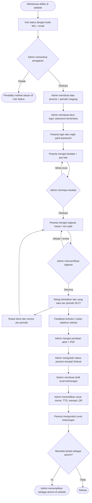

# Buku Alur Magang PILARA

Alur lengkap dari mahasiswa mendaftar sampai selesai magang dan menjadi alumni, beserta siapa
yang mengerjakan setiap langkah.

**Pelaku:** Mahasiswa / Peserta · Admin (atau Super Admin) · Sistem (otomatis)

## Diagram Alur

## Langkah demi Langkah

| No | Langkah | Pelaku | Menu / tempat | Hasil |
|---|---|---|---|---|
| 1 | Mengisi formulir pendaftaran 3 langkah dan mengunggah surat pengantar | Mahasiswa | Website → **Daftar Magang** | Kode pengajuan **MG-00000x** |
| 2 | Mengecek status pengajuan | Mahasiswa | Website → **Cek Status** (kode + email) | Status Menunggu / Disetujui / Ditolak dan catatan admin |
| 3 | Memeriksa dan menyetujui atau menolak pengajuan | Admin | **Pengajuan** → detail → **Simpan Status** | Status berubah; catatan tampil di Cek Status |
| 4 | Membuat data peserta dari pengajuan yang disetujui | Admin | Detail pengajuan → **Buat Data Peserta** | Peserta dengan nomor peserta |
| 5 | Melengkapi tanggal mulai dan selesai magang | Admin | **Data Peserta** → Edit | Periode magang tersimpan |
| 6 | Membuat akun login peserta | Admin | Detail peserta → **Buat Akun Login** | Password sementara (tampil sekali) |
| 7 | Login pertama dan mengganti password | Peserta | Halaman **Login** → **Profil** | Akun aktif dengan password sendiri |
| 8 | Mengisi biodata dan pas foto, lalu mengirim | Peserta | **Biodata** → **Kirim untuk Ditinjau** | Biodata "Menunggu ditinjau" |
| 9 | Meninjau biodata | Admin | **Biodata** → **Setujui biodata** / **Minta revisi** | Disetujui (terkunci) atau dikembalikan ke peserta |
| 10 | Mengisi logbook setiap hari kerja; mengajukan izin/sakit bila tidak masuk | Peserta | **Logbook Harian**, **Ajukan Izin / Sakit** | Logbook "Menunggu" |
| 11 | Memverifikasi logbook dan izin | Admin | **Logbook & Absensi** → **Simpan Verifikasi** | Diterima (terkunci) / Ditolak (bisa diperbaiki) |
| 12 | Rekap kehadiran dan uang saku per periode (tanggal 28 s.d. 27) | Sistem | **Rekap Kehadiran** (peserta), **Rekap Uang Saku** (admin) | Jumlah hari penuh, setengah hari, izin/sakit, uang saku |
| 13 | Rotasi divisi dan mentor per periode | Admin | Detail peserta → **Divisi & Mentor per Periode** | Divisi tercetak di logbook dan surat |
| 14 | Mengisi feedback (terbuka 1 bulan sebelum tanggal selesai) | Peserta | **Feedback** → **Kirim Feedback** | Feedback tercatat; bisa memilih bersedia tampil sebagai alumni |
| 15 | Mengisi penilaian akhir dan mengunduh lembar penilaian | Admin | **Penilaian** → **Simpan Penilaian** → PDF | Nilai akhir + predikat, PDF 1 halaman |
| 16 | Mengubah status peserta menjadi **Selesai** | Admin | **Data Peserta** → Edit | Sistem otomatis membuat draft surat |
| 17 | Menerbitkan surat keterangan | Admin | **Surat Keterangan** → **Terbitkan Surat** | Nomor surat, tanda tangan, stempel, QR verifikasi |
| 18 | Mengunduh surat keterangan | Peserta | **Surat Keterangan** | PDF surat; feedback terkunci |
| 19 | Menampilkan peserta sebagai alumni (bila bersedia) | Admin | **Alumni** → pilih peserta → lengkapi project | Kartu alumni di website |

## Aturan Penting

- **Akun peserta dibuat admin.** Mahasiswa tidak bisa membuat akun sendiri; hanya yang sudah
  diterima yang mendapat akun.
- **Batas isi logbook mundur** (bawaan 7 hari) dan **tanggal awal periode** (bawaan 28) diatur
  Super Admin di **Pengaturan Magang**. Tanggal yang terlewat terkunci, kecuali dibuka admin.
- **Logbook yang sudah diterima terkunci.** Logbook yang ditolak atau perlu review bisa diperbaiki
  peserta lalu diverifikasi ulang.
- **Uang saku** dihitung per periode: hari penuh dan setengah hari memakai tarif yang berlaku pada
  tanggal itu. Hari yang ditolak tidak dihitung.
- **Syarat surat terbit:** status peserta Selesai, biodata disetujui, penilaian sudah diisi, dan
  feedback sudah dikirim.
- **Keaslian surat** bisa dicek siapa saja dengan memindai QR di surat (halaman verifikasi hanya
  menampilkan nama, periode, dan nomor surat).

## Lihat Juga

- [Panduan Peserta](panduan-peserta.md)
- [Panduan Admin](panduan-admin.md)
- [Panduan Super Admin](panduan-super-admin.md)
