# Panduan Admin

Panduan untuk admin (dan super admin) mengelola peserta magang sehari-hari: memproses pendaftaran,
membuat akun, memverifikasi biodata dan logbook, menilai, sampai menerbitkan surat keterangan.
Gambar memakai data contoh.

## 1. Login dan Menu

Login lewat tombol **Login** di website. Menu admin dikelompokkan di sidebar:

| Grup | Menu |
|---|---|
| Utama | Dashboard, Monitoring |
| Kelola Peserta | Pengajuan, Data Peserta, Biodata, Logbook & Absensi, Penilaian, Feedback, Surat Keterangan, Divisi, Hari Libur |
| Laporan | Rekap Uang Saku, Laporan & Export |
| Konten Website | Profil Perusahaan, Banner, Konten, Alumni, Dokumentasi, FAQ |

Angka oranye di samping menu menunjukkan jumlah yang **perlu ditindaklanjuti** (pengajuan
menunggu, biodata menunggu tinjauan). Di HP, buka menu lewat tombol garis tiga di kiri atas.

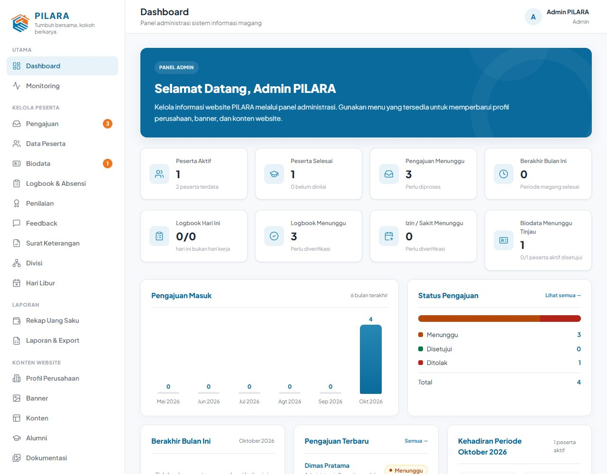

## 2. Memproses Pengajuan Magang

1. Buka **Pengajuan**. Gunakan tab status (Semua, Menunggu, Disetujui, Ditolak) dan kotak cari.
2. Klik nama pendaftar untuk melihat detail dan **surat pengantar**.
3. Di panel **Proses Pengajuan**, pilih **Disetujui** atau **Ditolak**, isi **catatan untuk
   pendaftar** (wajib bila ditolak), lalu klik **Simpan Status**. Catatan ini terlihat pendaftar di
   Cek Status.
4. Untuk pengajuan yang disetujui, klik **Buat Data Peserta**.

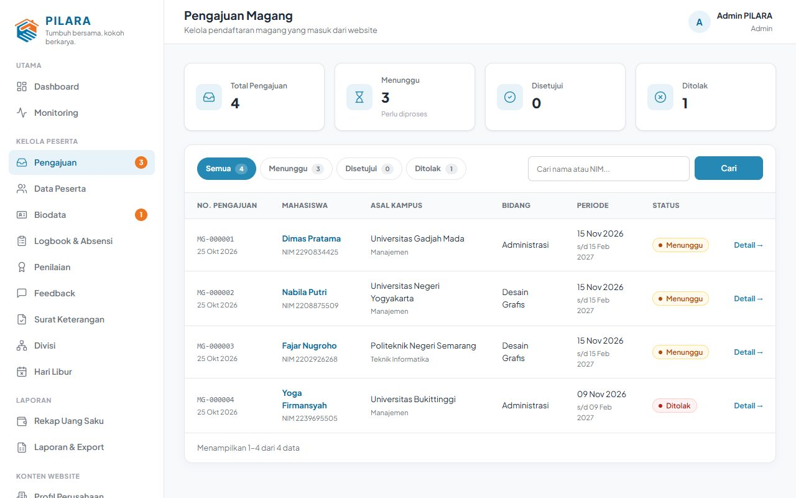

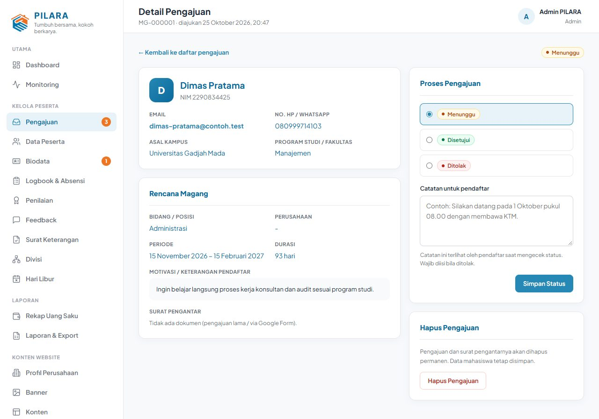

## 3. Melengkapi Data Peserta, Divisi, dan Mentor

1. Di form data peserta, isi **tanggal mulai** dan **tanggal selesai** magang, lalu simpan.
2. Di halaman detail peserta, kartu **Divisi & Mentor per Periode**: pilih divisi dan isi nama
   mentor untuk setiap periode. Periode yang dikosongkan mengikuti periode sebelumnya, sehingga
   rotasi divisi cukup diisi saat berpindah.

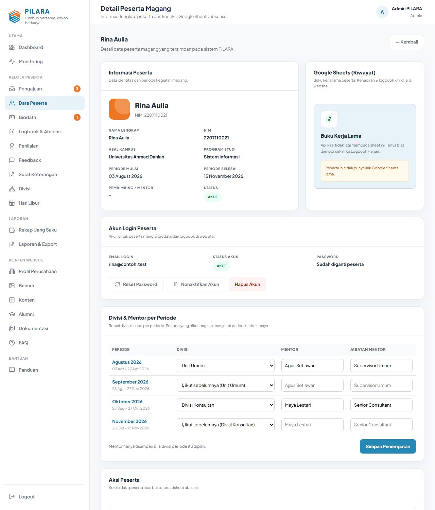

## 4. Membuat dan Mengelola Akun Login Peserta

1. Detail peserta → kartu **Akun Login Peserta** → isi email → **Buat Akun Login**.
2. **Password sementara** tampil **satu kali** di kotak berwarna. Catat dan berikan kepada peserta.
   Peserta wajib menggantinya saat login pertama.
3. Tombol lain di kartu yang sama:
   - **Reset Password**: membuat password sementara baru (yang lama tidak berlaku). Klik **OK** di
     dialog konfirmasi, lalu salin kode yang muncul.
   - **Nonaktifkan Akun** / **Aktifkan Akun**: akun nonaktif langsung keluar dan tidak bisa login.
   - **Hapus Akun**: menghapus akun login saja; data peserta tetap ada.

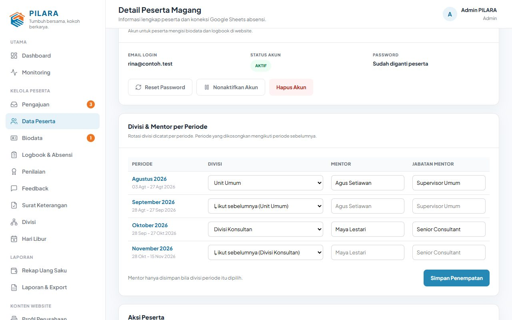

## 5. Meninjau Biodata

1. Buka **Biodata** (daftar semua peserta beserta status biodatanya), lalu pilih peserta.
2. Periksa data dan pas foto.
3. Klik **Setujui biodata**, atau isi catatan lalu **Minta revisi**. Peserta melihat catatan revisi
   dan bisa mengirim ulang.

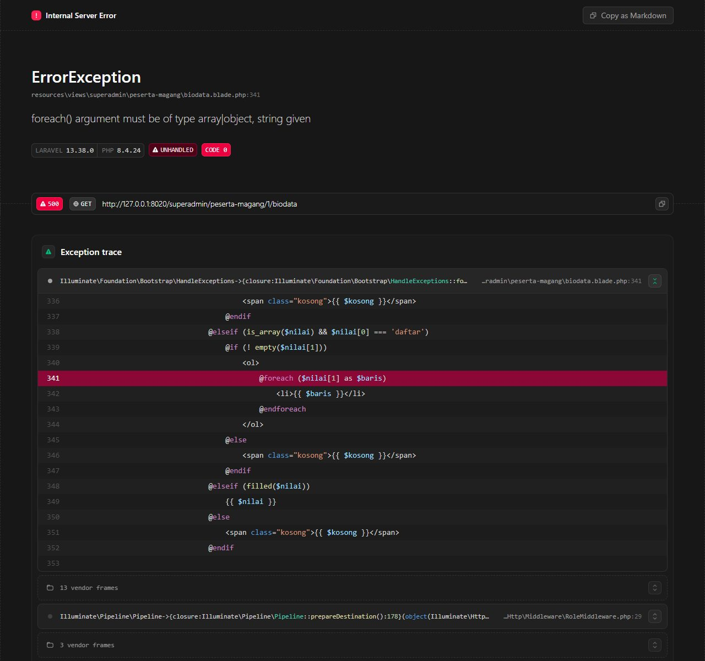

## 6. Memverifikasi Logbook dan Izin

1. Buka **Logbook & Absensi**, pilih peserta, dan pilih **periode**.
2. **Izin / Sakit** di bagian atas: klik **Terima**, atau isi alasan lalu **Tolak**.
3. Di tabel logbook, centang hari-hari yang akan diverifikasi, pilih **Diterima** / **Ditolak** /
   **Review**, isi catatan (wajib bila ditolak), lalu klik **Simpan Verifikasi**.
4. Kolom **Kunci**: klik **Buka kunci** agar peserta bisa mengisi tanggal yang sudah melewati batas.
5. **Unduh PDF** mencetak logbook satu periode (format Daily Aktivitas).
6. **Impor Riwayat dari Buku Kerja Lama** (opsional): unggah file `.xlsx` lama milik peserta.

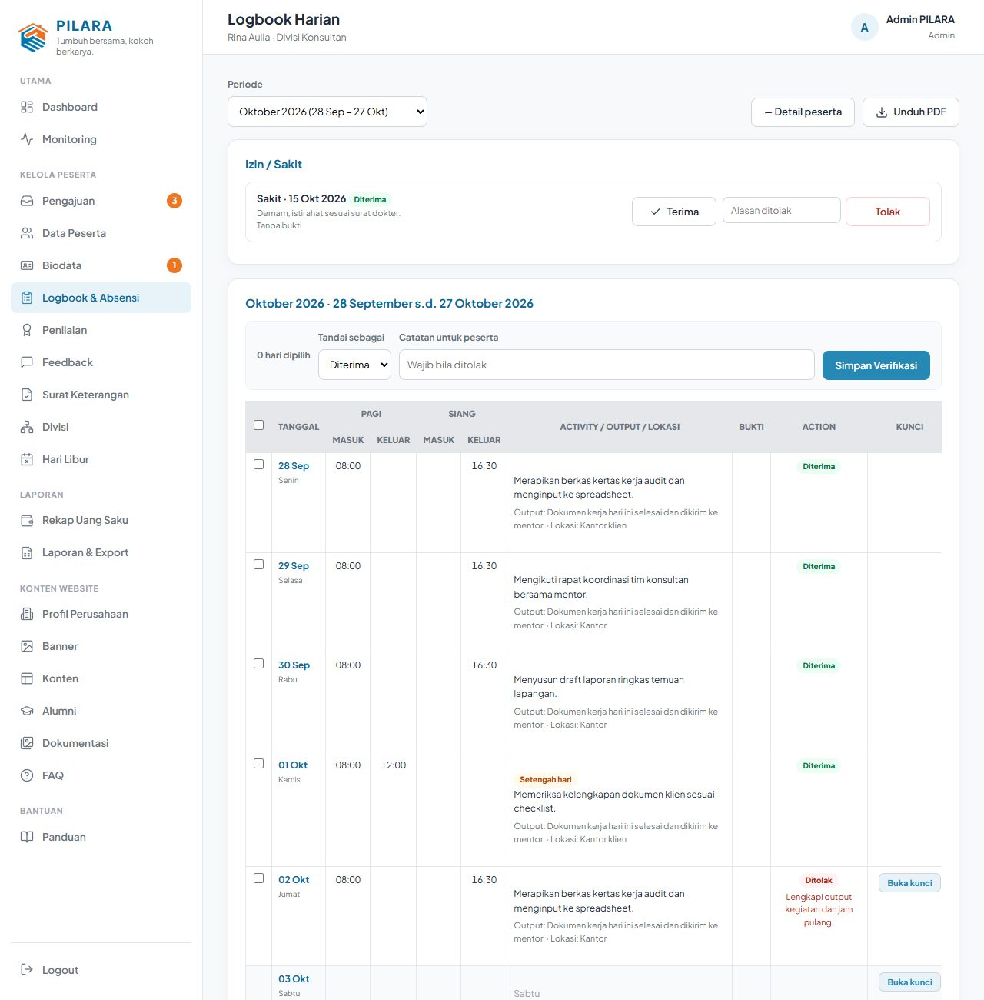

## 7. Monitoring

**Monitoring** menampilkan semua peserta aktif: progres biodata, logbook hari ini, logbook yang
menunggu verifikasi, dan izin yang menunggu.

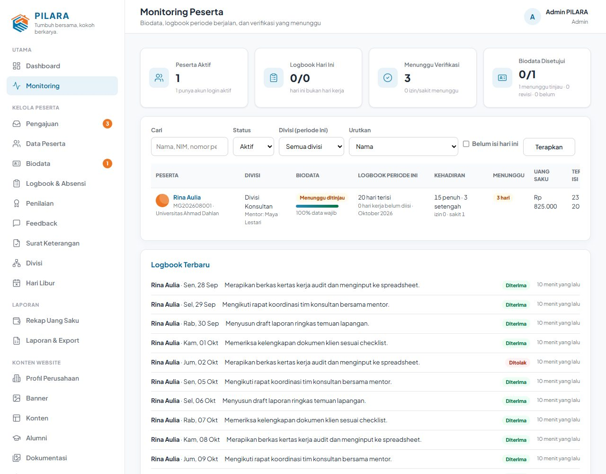

## 8. Penilaian Akhir

1. Buka **Penilaian**, pilih peserta.
2. Isi nilai **1–100** untuk setiap aspek Hard Skill dan Soft Skill. Nilai akhir dan predikat
   langsung dihitung.
3. Isi tiga kolom **kesimpulan** (maksimal 600 karakter dan 5 baris per kolom, ada penghitung
   karakter) agar lembar penilaian tetap 1 halaman.
4. Klik **Simpan Penilaian**, lalu **Lembar Penilaian (PDF)** untuk mengunduh. Tanda tangan dan
   stempel yang diatur Super Admin tercetak otomatis.

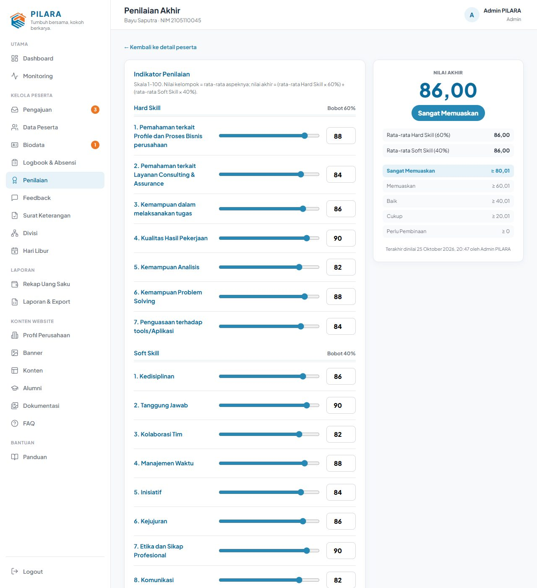

## 9. Menyelesaikan Magang dan Menerbitkan Surat Keterangan

1. Edit data peserta, ubah **status** menjadi **Selesai**. Sistem otomatis membuat **draft surat**.
2. Buka **Surat Keterangan**, pilih peserta. Daftar syarat menunjukkan yang sudah dan belum
   terpenuhi: status Selesai, biodata disetujui, penilaian diisi, feedback dikirim.
3. Klik **Pratinjau PDF** untuk memeriksa, lalu **Terbitkan Surat**. Nomor surat diberikan otomatis
   (format diatur Super Admin) dan tidak berubah bila diterbitkan ulang.
4. Surat terbit memuat tanda tangan, stempel, dan **QR verifikasi**. Tautan halaman verifikasi juga
   tampil di halaman surat.

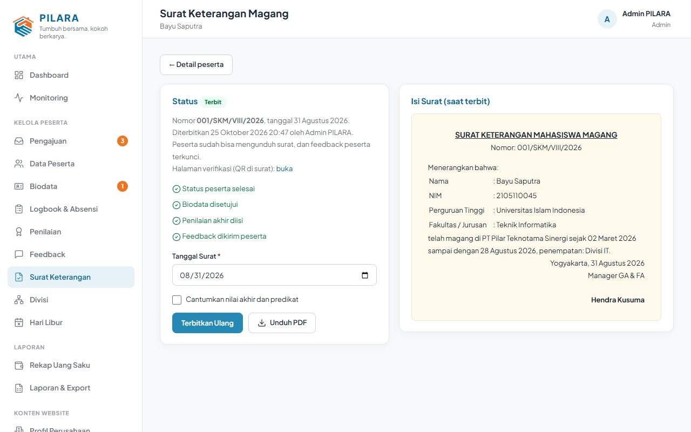

## 10. Feedback dan Laporan

- **Feedback**: rekap rata-rata kepuasan dan jawaban setiap peserta.
- **Rekap Uang Saku**: kehadiran dan uang saku per periode.
- **Laporan & Export**: tab Kehadiran & Uang Saku, Nilai Akhir, dan Feedback Magang. Unduh sebagai
  **Excel**, **PDF**, **CSV**, atau **Cetak**.

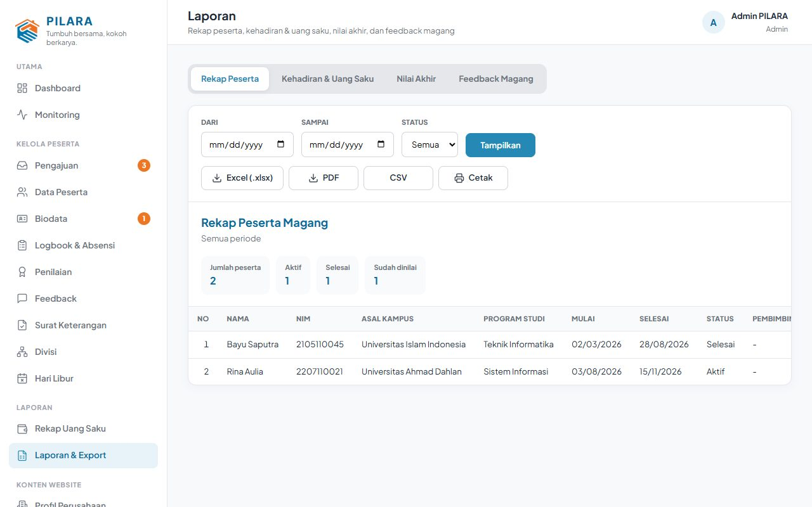

## 11. Hari Libur

Menu **Hari Libur** (di dalam Pengaturan Magang): tambah tanggal libur nasional atau cuti bersama.
Hari libur tidak dihitung sebagai hari kerja di logbook dan rekap.

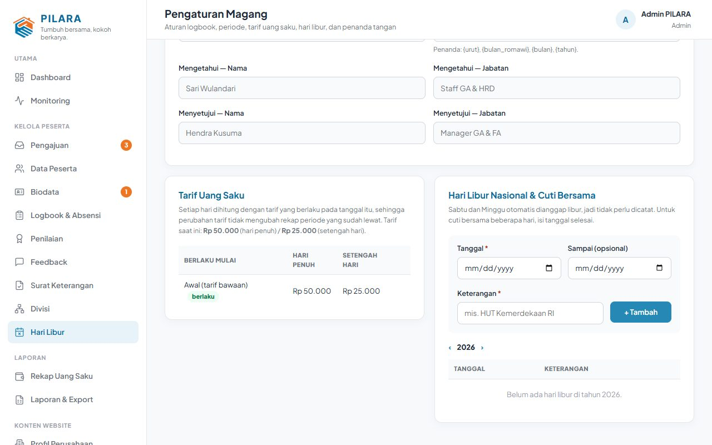

## 12. Konten Website

| Menu | Fungsi |
|---|---|
| Profil Perusahaan | Nama, alamat, kontak, deskripsi (dipakai juga di kop surat dan PDF). |
| Banner | Banner utama beranda. |
| Konten | Teks pengumuman, persyaratan, alur, dan tautan Google Form. |
| Alumni | Kartu alumni di beranda: pilih dari peserta yang selesai dan bersedia, atau input manual. |
| Dokumentasi | Galeri foto kegiatan di beranda: unggah, judul, tanggal, keterangan, urutan, tampil/sembunyikan. |
| FAQ | Pertanyaan yang sering diajukan: tambah, ubah, urutkan, sembunyikan. |

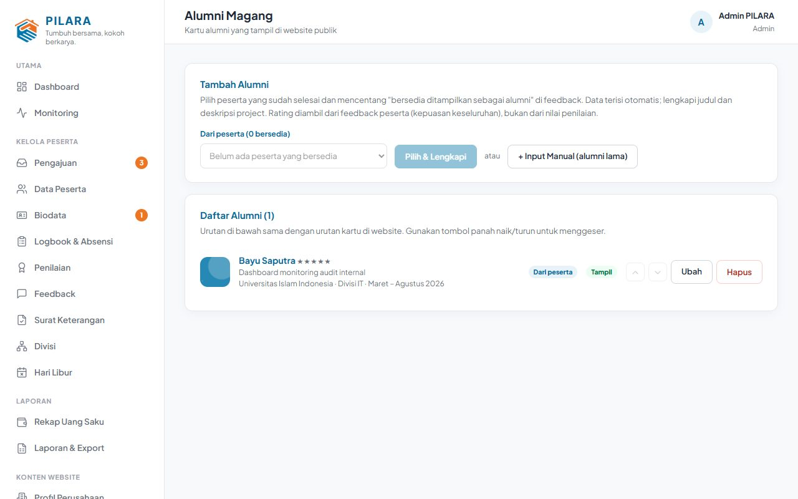

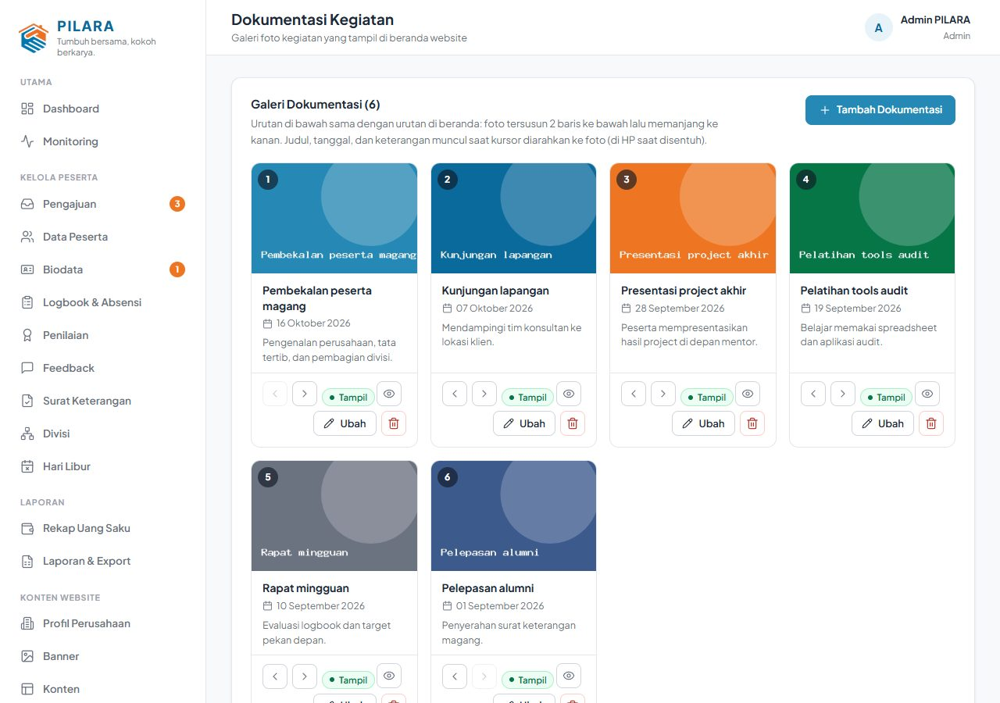

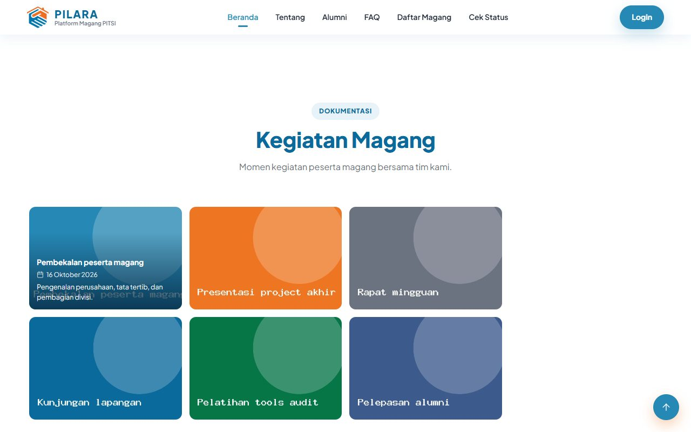

## Pertanyaan Umum

| Pertanyaan | Jawaban |
|---|---|
| Tombol Terbitkan Surat tidak muncul | Cek daftar syarat: status Selesai, biodata disetujui, penilaian diisi, feedback dikirim. |
| Password sementara tidak terlihat | Pastikan memilih **OK** di dialog konfirmasi. Kode hanya tampil sekali; bila terlewat, tekan Reset Password lagi. |
| Peserta tidak bisa mengisi tanggal lama | Buka **Logbook & Absensi** → kolom Kunci → **Buka kunci**. |
| Pengaturan Magang tidak bisa diubah | Hanya Super Admin yang boleh mengubah aturan umum, tarif, dan penanda tangan. |
