# Panduan Peserta Magang

Panduan memakai PILARA untuk mahasiswa: dari mendaftar sampai mengunduh surat keterangan magang.
Gambar memakai data contoh.

## 1. Mendaftar Magang

1. Buka website PILARA, lalu klik **Daftar Magang** di menu atas.
2. Isi formulir **3 langkah**: Data Diri, Akademik, dan Rencana Magang.
3. Unggah **surat pengantar** dari kampus (PDF/JPG/PNG, maksimal 2 MB).
4. Klik **Kirim Pendaftaran**. Catat **kode pengajuan** yang muncul, misalnya `MG-000012`.

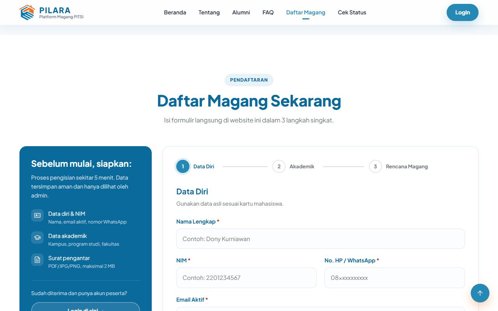

## 2. Mengecek Status Pengajuan

1. Buka bagian **Cek Status** di website.
2. Masukkan **kode pengajuan** dan **email** yang dipakai saat mendaftar.
3. Status tampil: **Menunggu**, **Disetujui**, atau **Ditolak**, beserta catatan dari admin.

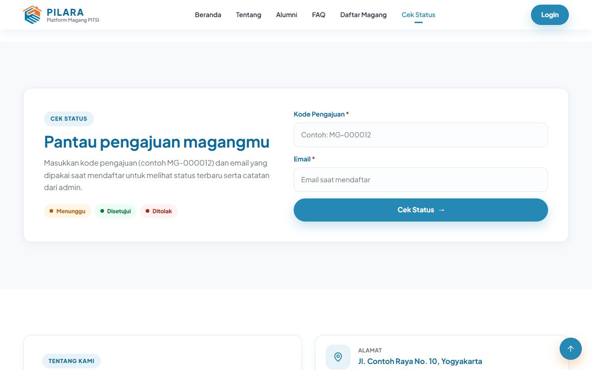

Bila disetujui, admin akan membuatkan akun login dan memberikan **email** serta **password
sementara** kepada Anda.

## 3. Login Pertama dan Ganti Password

1. Klik **Login** di pojok kanan atas website.
2. Masukkan email dan password sementara dari admin.
3. Anda langsung diarahkan ke halaman **Profil**. Buat **password baru** sebelum bisa membuka menu
   lain.
4. Setelah password diganti, halaman **Profil** juga menampilkan panel **foto profil**.

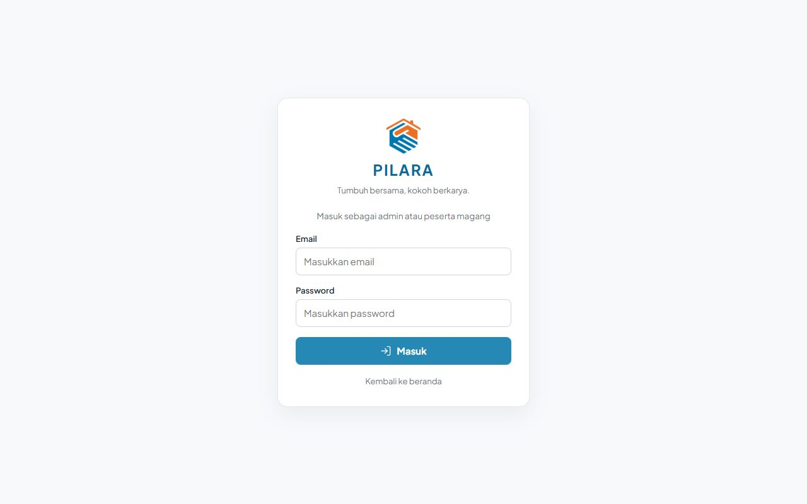

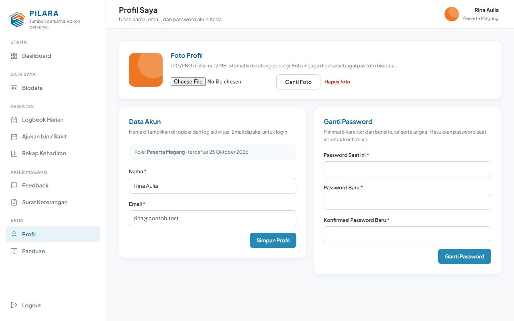

> Lupa password? Hubungi admin untuk **Reset Password**. Admin akan memberi password sementara
> baru, dan Anda wajib menggantinya lagi saat login.

## 4. Dashboard

Dashboard menampilkan ringkasan magang Anda:

- **Logbook hari ini**: sudah diisi atau belum, dan statusnya.
- **Pengingat**: tanggal yang hampir terkunci, logbook yang ditolak, biodata yang perlu diperbaiki,
  dan feedback yang sudah dibuka.
- **Periode berjalan**: jumlah hari hadir penuh, setengah hari, izin/sakit, dan perkiraan uang saku.
- **Kalender kehadiran** berwarna sesuai status setiap hari.

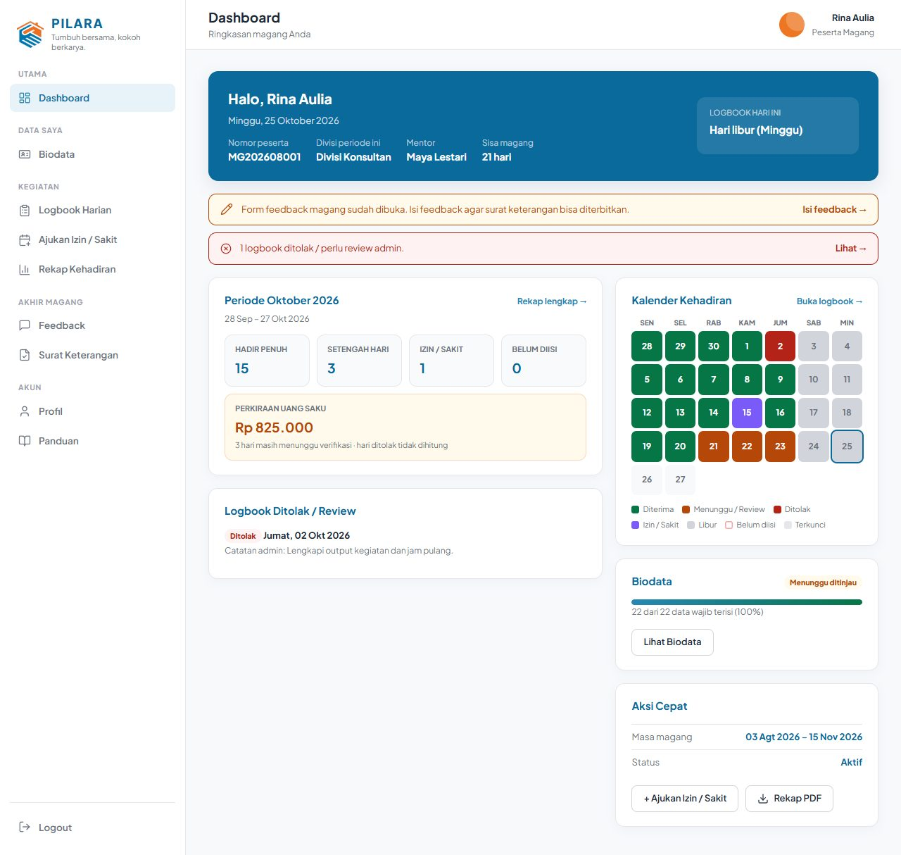

## 5. Mengisi Biodata

1. Buka menu **Biodata**.
2. Unggah **Pas Foto** (foto wajah terbaru, latar polos, JPG/PNG maksimal 2 MB). Pratinjau muncul
   sebelum disimpan. Foto ini juga menjadi foto profil.
3. Isi semua data bertanda wajib. Klik **Simpan Draft** kapan saja untuk menyimpan sementara;
   progres (%) akan naik.
4. Setelah lengkap, centang pernyataan, lalu klik **Kirim untuk Ditinjau**.
5. Bila admin meminta revisi, catatan revisi tampil di atas form. Perbaiki lalu kirim lagi.
6. Setelah **disetujui**, biodata terkunci. Pas foto masih boleh diganti.

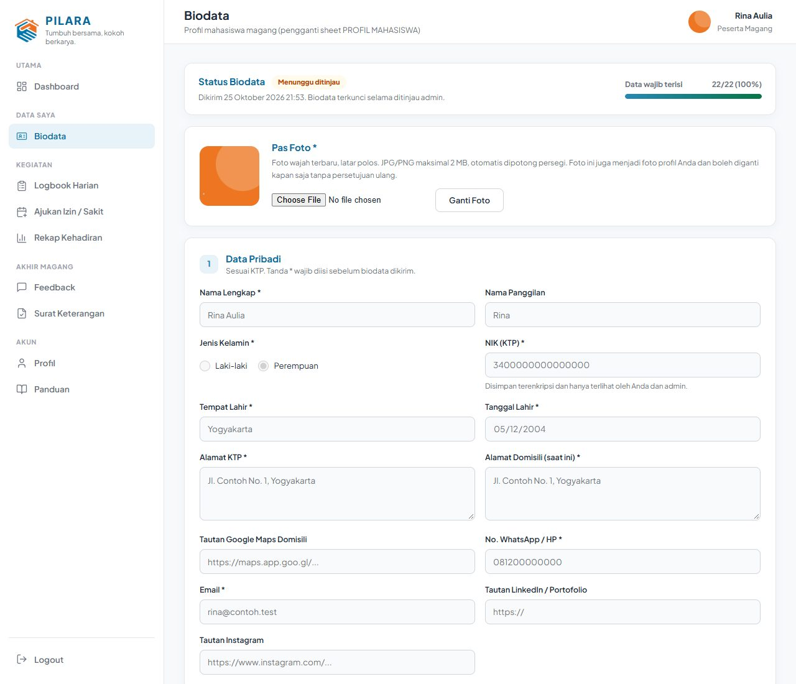

## 6. Mengisi Logbook Harian

Logbook diisi **setiap hari kerja**.

1. Buka menu **Logbook Harian**, lalu klik tanggal yang ingin diisi.
2. Pilih kehadiran **Hadir** (atau **Libur**).
3. Isi jam:
   - **Hari penuh**: isi **pagi masuk** dan **siang keluar**.
   - **Setengah hari**: isi satu sesi saja, pagi masuk–keluar atau siang masuk–keluar.
4. Isi **Activity** (wajib), **Output**, dan **Lokasi**. Bila perlu, unggah bukti (JPG/PNG/PDF,
   maksimal 2 MB per file, 3 file per hari).
5. Klik **Simpan Logbook**. Statusnya menjadi **Menunggu** verifikasi admin.

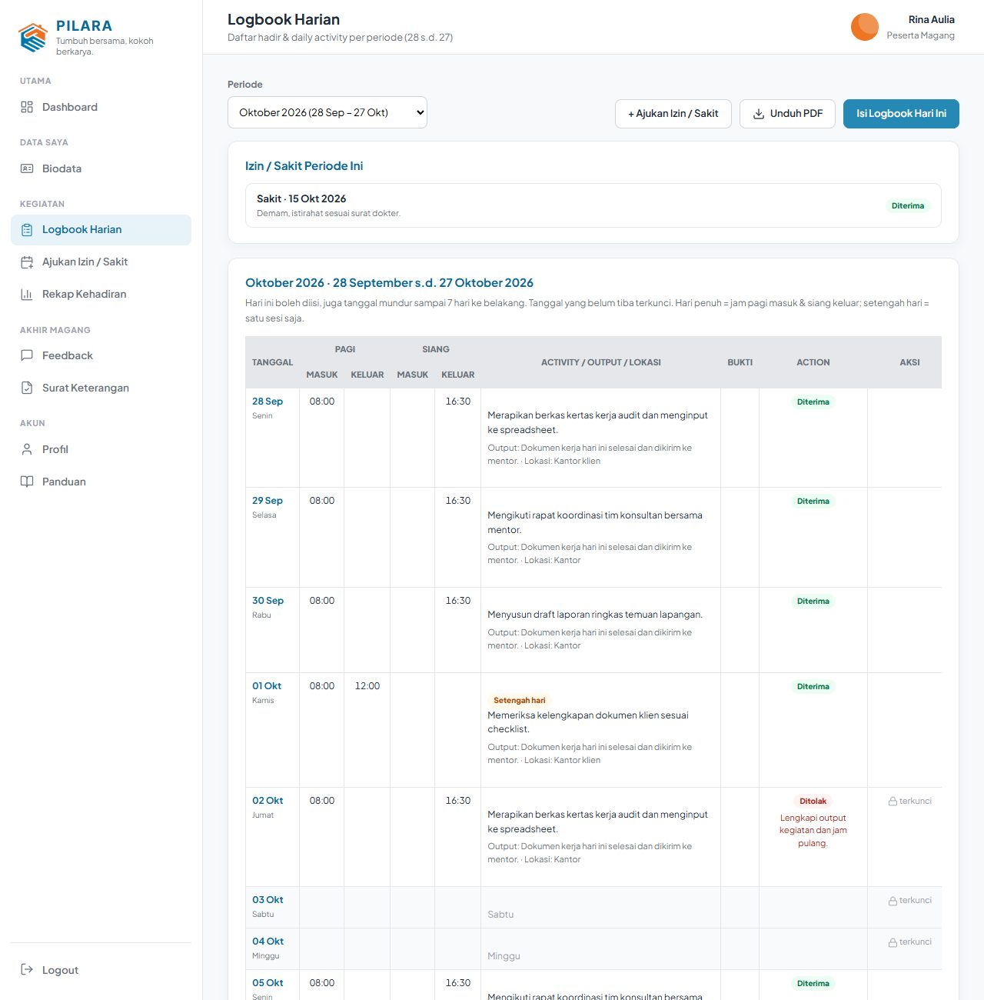

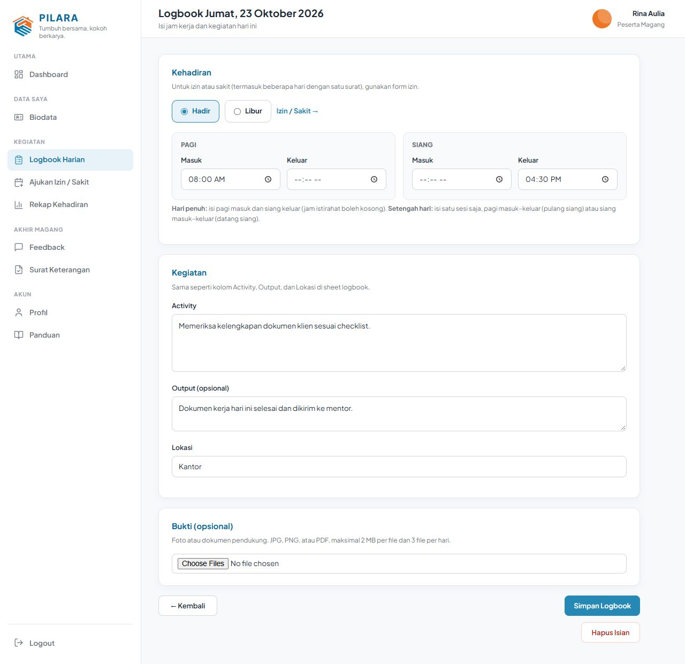

**Aturan logbook:**

- Tanggal **mendatang** belum bisa diisi.
- Tanggal yang sudah lewat hanya bisa diisi sampai **batas isi mundur** (bawaan 7 hari). Lewat dari
  itu tanggal **terkunci**; minta admin membuka kunci bila perlu.
- Logbook **Diterima** terkunci. Logbook **Ditolak** atau **Review** bisa diperbaiki; baca catatan
  admin lalu simpan ulang.
- Di bawah tabel ada **Rekap Periode** dan tombol **Unduh PDF**.

## 7. Mengajukan Izin atau Sakit

1. Buka menu **Ajukan Izin / Sakit**.
2. Pilih **Izin** atau **Sakit**, lalu isi **tanggal mulai** dan **tanggal selesai** sesuai surat.
3. Isi keterangan. Untuk **sakit**, bukti (surat dokter) wajib diunggah.
4. Klik **Ajukan**. Setiap hari kerja dalam rentang itu otomatis tercatat izin/sakit dan menunggu
   persetujuan admin.

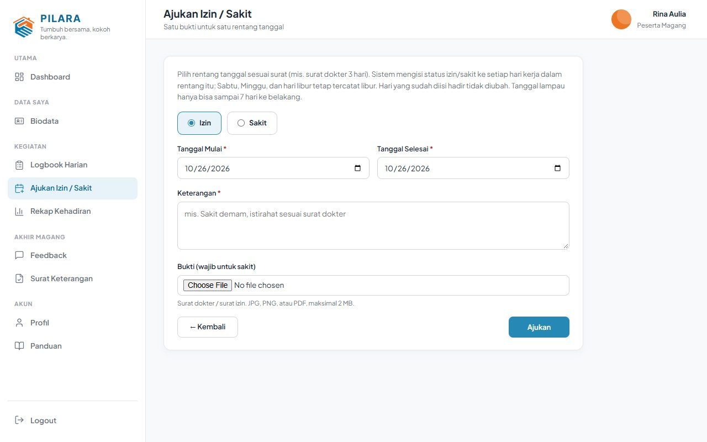

## 8. Rekap Kehadiran dan Uang Saku

Menu **Rekap Kehadiran** menampilkan rekap per periode (tanggal **28 s.d. 27** bulan berikutnya):
hari hadir penuh, setengah hari, izin/sakit, dan perkiraan uang saku. Hari yang ditolak tidak
dihitung. Pilih periode lain di bagian atas, atau unduh PDF.

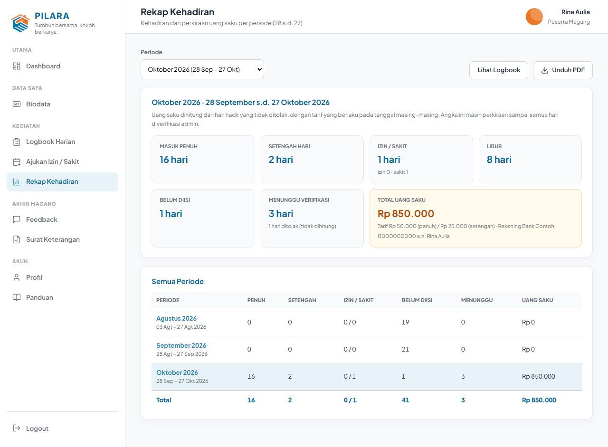

## 9. Feedback Magang

1. Menu **Feedback** terbuka **1 bulan sebelum tanggal selesai** magang. Sebelum itu menu tampil
   dengan ikon gembok.
2. Isi semua pertanyaan skala, pertanyaan terbuka, dan kesediaan merekomendasikan.
3. Centang **bersedia ditampilkan sebagai alumni** bila Anda setuju nama, kampus, dan cerita
   project Anda tampil di website.
4. Klik **Kirim Feedback**. Feedback masih bisa diubah sampai surat keterangan terbit.

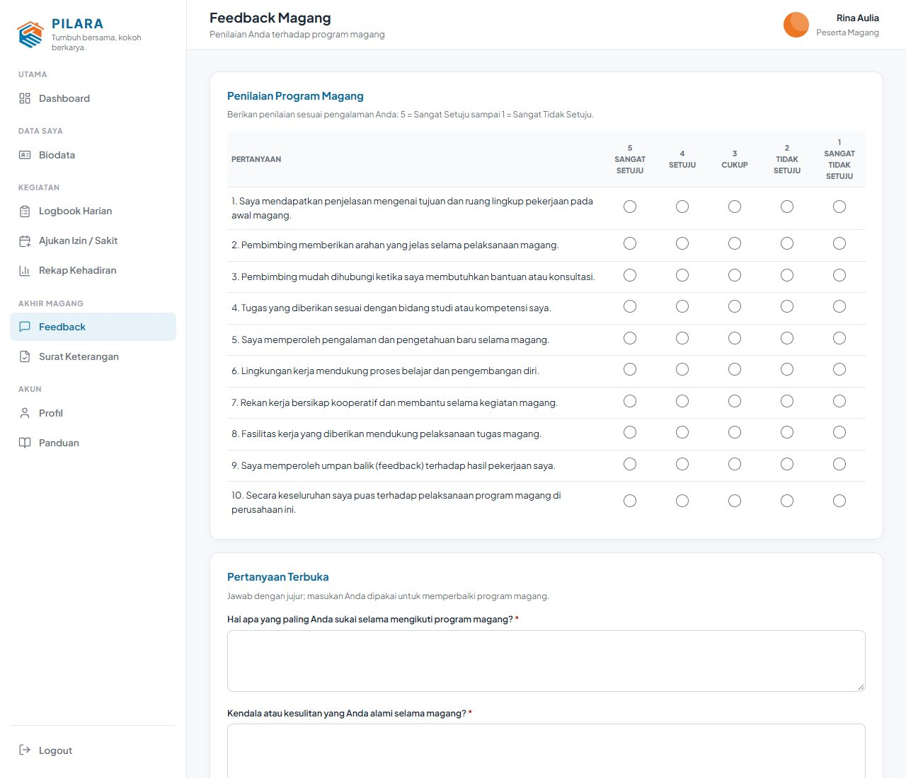

## 10. Mengunduh Surat Keterangan

1. Setelah magang selesai, admin menerbitkan surat keterangan bila syarat terpenuhi: biodata
   disetujui, penilaian sudah diisi, dan feedback sudah dikirim.
2. Buka menu **Surat Keterangan**. Bila surat sudah terbit, nomor dan tanggal surat tampil di sana.
   Klik **Unduh Surat (PDF)**.

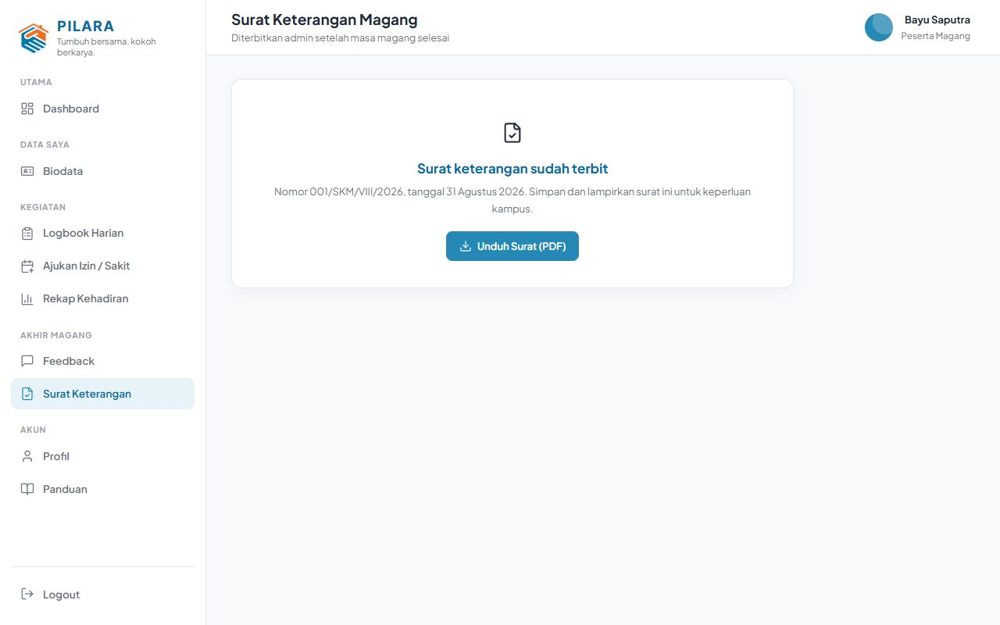

3. Surat memuat kop perusahaan, data magang Anda, tanda tangan, stempel, dan **QR code**.

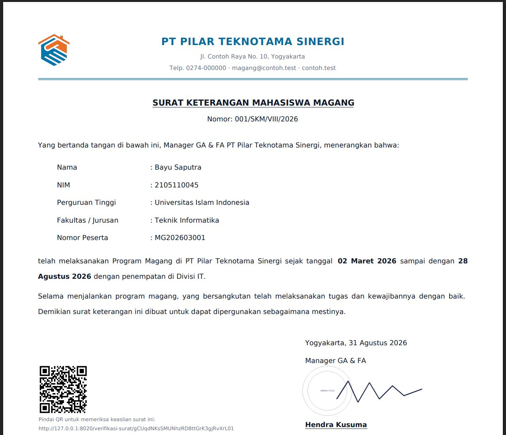

4. Siapa pun (misalnya pihak kampus) bisa memindai QR untuk memeriksa keaslian surat. Halaman
   verifikasi hanya menampilkan nama, periode, dan nomor surat.

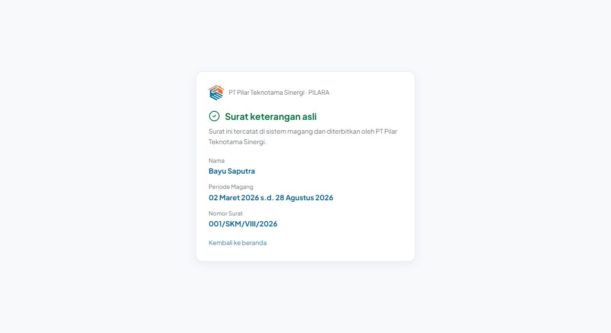

Setelah magang selesai, logbook dan biodata hanya bisa dilihat, tidak bisa diubah lagi.

## Pertanyaan Umum

| Pertanyaan | Jawaban |
|---|---|
| Menu Feedback masih terkunci | Terbuka mulai 1 bulan sebelum tanggal selesai magang. |
| Tanggal logbook lama tidak bisa diisi | Melewati batas isi mundur. Minta admin **membuka kunci** tanggal itu. |
| Uang saku 0 padahal hadir | Jam belum lengkap (butuh pagi masuk + siang keluar, atau satu sesi lengkap), atau logbook ditolak. |
| Periode "November" mulai 28 Oktober | Benar: periode berjalan tanggal 28 s.d. 27 bulan berikutnya. |
| Tidak bisa login | Akun dinonaktifkan atau password salah. Hubungi admin untuk reset password. |
