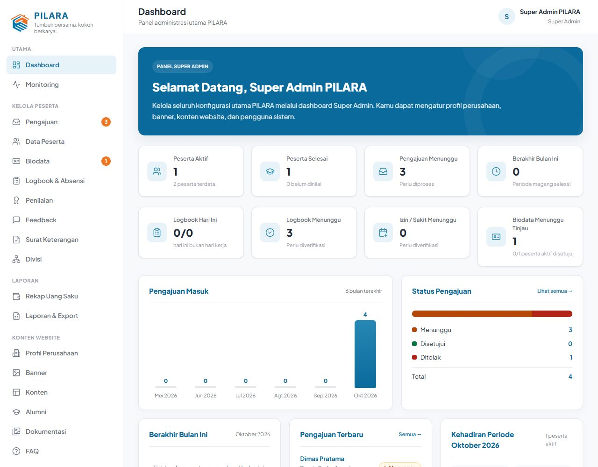
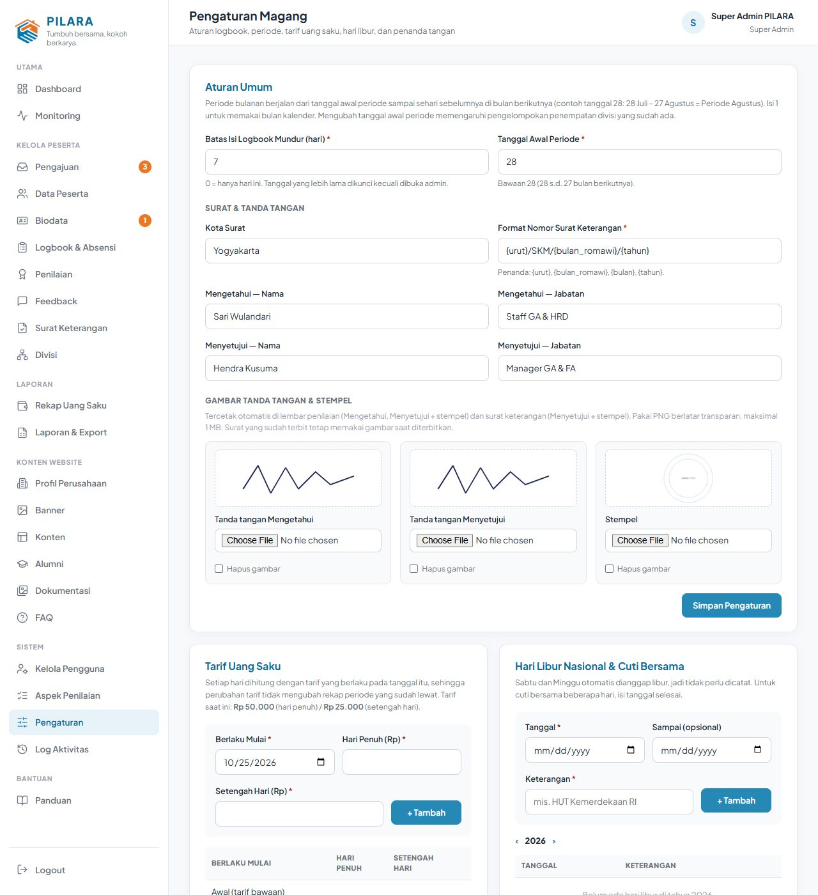
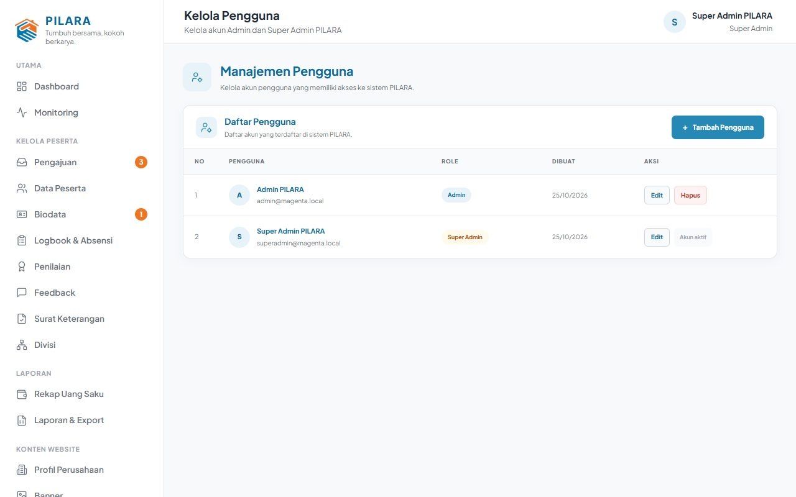
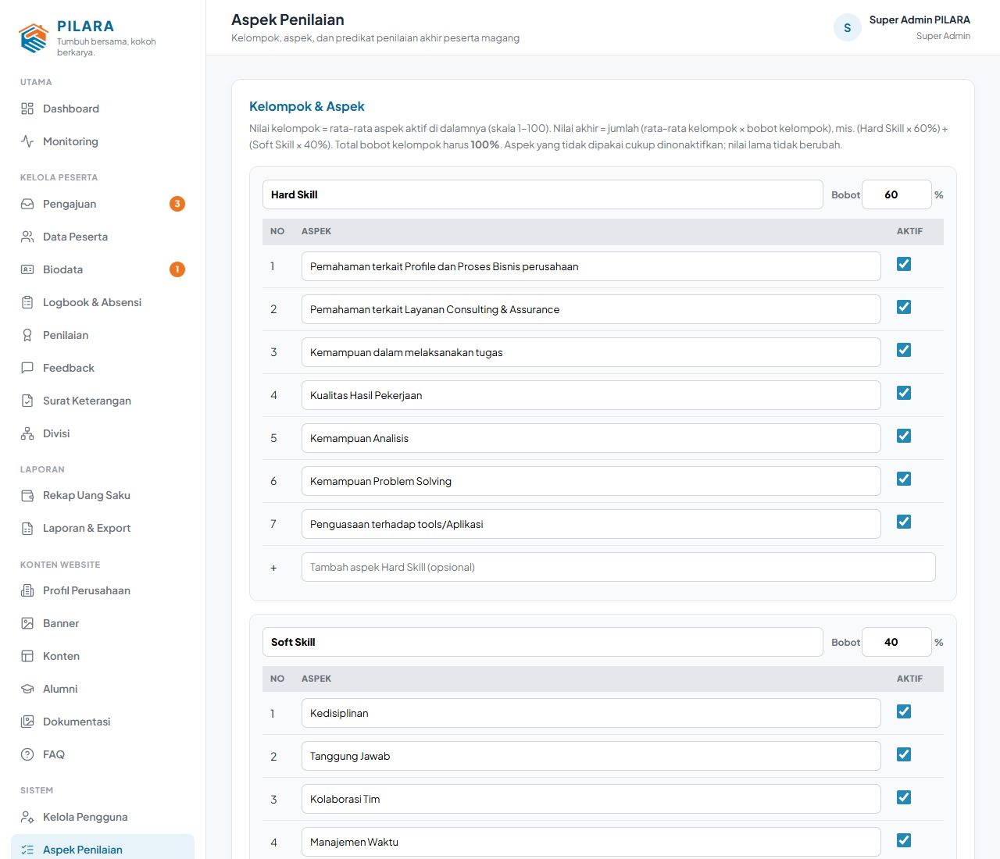
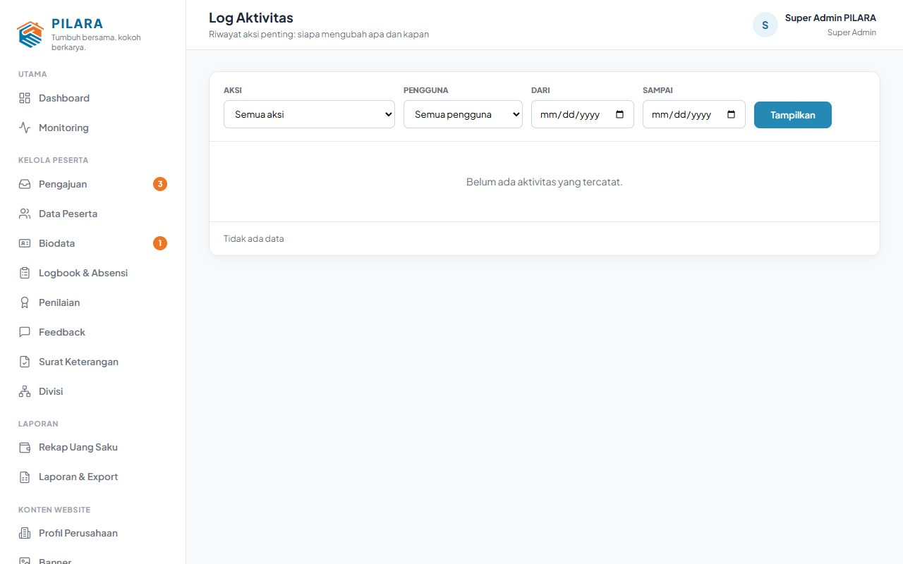

# Panduan Super Admin

Super Admin bisa melakukan **semua pekerjaan admin** (lihat [Panduan Admin](panduan-admin.md))
ditambah grup menu **Sistem**: Kelola Pengguna, Aspek Penilaian, Pengaturan, dan Log Aktivitas.
Gambar memakai data contoh.

## 1. Persiapan Awal (sekali di awal)

Urutan yang disarankan sebelum menerima peserta:

1. **Profil Perusahaan**: nama, alamat, kota, kontak (dipakai di kop surat dan PDF).
2. **Pengaturan Magang**: aturan umum, tarif uang saku, penanda tangan, tanda tangan, dan stempel.
3. **Divisi**: daftar divisi tempat peserta ditempatkan.
4. **Aspek Penilaian**: periksa kelompok, bobot, aspek, dan tabel predikat.
5. **Kelola Pengguna**: buat akun untuk admin lain.

## 2. Pengaturan Magang

Menu **Sistem → Pengaturan**. Admin hanya bisa melihat halaman ini (kecuali bagian hari libur).

| Bagian | Isi |
|---|---|
| Aturan umum | **Batas isi logbook mundur** (hari; 0 = hanya hari ini) dan **tanggal awal periode** (bawaan 28: periode 28 s.d. 27). |
| Surat & tanda tangan | Kota surat, **format nomor surat** (penanda `{urut}`, `{bulan_romawi}`, `{bulan}`, `{tahun}`), nama dan jabatan **Mengetahui** dan **Menyetujui**. |
| Gambar tanda tangan & stempel | Unggah tanda tangan Mengetahui, tanda tangan Menyetujui, dan stempel (PNG berlatar transparan, maksimal 1 MB). Pratinjau muncul sebelum disimpan. |
| Tarif uang saku | Tarif hari penuh dan setengah hari, berlaku mulai tanggal tertentu. Tarif lama tetap dipakai untuk tanggal sebelumnya. |
| Hari libur | Libur nasional dan cuti bersama (admin juga bisa mengelola). |

**Di mana tanda tangan tercetak:**

- **Lembar penilaian**: tanda tangan Mengetahui dan Menyetujui, stempel di Menyetujui. Kolom
  Penilai (mentor) dibiarkan kosong untuk tanda tangan basah.
- **Surat keterangan**: tanda tangan dan stempel Menyetujui.
- Surat yang **sudah terbit** tetap memakai tanda tangan saat diterbitkan, walaupun gambar atau nama
  penanda tangan diganti kemudian.

## 3. Kelola Pengguna

Menu **Sistem → Kelola Pengguna**: tambah, ubah, atau hapus akun **Admin** dan **Super Admin**.
Akun peserta tidak tampil di sini; akun peserta dikelola dari detail peserta (lihat Panduan Admin).

## 4. Aspek Penilaian

Menu **Sistem → Aspek Penilaian**:

- **Kelompok** dan **bobotnya** (bawaan Hard Skill 60%, Soft Skill 40%; total harus 100%).
- **Aspek** di setiap kelompok (bisa ditambah, diubah, dinonaktifkan).
- **Tabel predikat** (rentang nilai dan keterangannya).

Penilaian yang sudah tersimpan tidak berubah saat aspek atau bobot diubah.

## 5. Log Aktivitas

Menu **Sistem → Log Aktivitas** mencatat tindakan penting: proses pengajuan, akun peserta, verifikasi
biodata dan logbook, penilaian, surat, perubahan pengaturan, dan konten website. Gunakan filter untuk
mencari tindakan tertentu. Password tidak pernah dicatat.

## 6. Keamanan

- Jangan membagikan password akun Admin atau Super Admin. Setiap admin sebaiknya punya akun sendiri
  agar tercatat di Log Aktivitas.
- Bila admin berhenti bertugas, hapus atau ubah akunnya di **Kelola Pengguna**.
- Dokumen pribadi peserta (surat pengantar, biodata, bukti logbook) hanya bisa dibuka admin dan super
  admin, atau pemiliknya sendiri.
